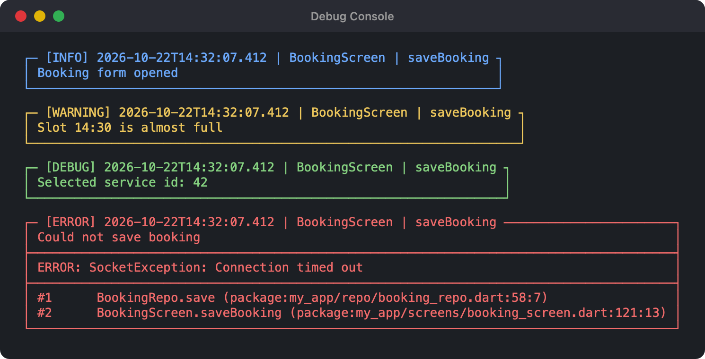

# log_tracking

A small logger for Flutter apps. It prints readable logs to the console, forwards them to tools like Firebase Crashlytics or Sentry, and can store logs on the device and upload them to your own server, even after the app was offline.



## Features

- **Four log levels:** `Log.i`, `Log.w`, `Log.e` and `Log.d`.
- **Readable console output:** each log shows its level, time, class and method in a colored box.
- **Callbacks for each level:** send logs to Crashlytics, Sentry or anything else.
- **Offline storage:** logs are saved on the device and uploaded when there is a connection.
- **Safe:** logging never throws and never crashes your app.

## Installation

```yaml
dependencies:
  log_tracking: ^0.5.0
```

## Quick start

Call `Log.init` once, before `runApp`:

```dart
import 'package:log_tracking/log_tracking.dart';

Future<void> main() async {
  WidgetsFlutterBinding.ensureInitialized();

  await Log.init(
    onError: (log) => debugPrint('Error: ${log.error}'),
  );

  runApp(const MyApp());
}
```

Then log from anywhere:

```dart
Log.i('Booking form opened');
Log.w('Slot 14:30 is almost full');
Log.d('Selected service id: 42');

try {
  await saveBooking();
} catch (e, stack) {
  Log.e(e, stack: stack, message: 'Could not save booking');
}
```

## Log levels

| Method | Use for | Console (debug builds) | Saved on device | Uploaded to your server |
|---|---|:---:|:---:|:---:|
| `Log.i(text)` | Normal events | ✓ | ✓ | ✓ |
| `Log.w(text)` | Something unexpected but not an error | ✓ | ✓ | ✓ |
| `Log.e(error)` | Exceptions and errors | ✓ | ✓ | ✓ (starts the upload) |
| `Log.d(text)` | Development details | ✓ | – | – |

"Saved" and "uploaded" only apply when you turn them on (see below). In release builds nothing is printed to the console; the callbacks still run.

## Sending logs to Crashlytics or Sentry

Every level has its own callback. Each one receives a `LogInfo` with the text, error, stack trace, class and method name.

```dart
await Log.init(
  onInfo: (log) {
    FirebaseCrashlytics.instance.log('INFO: ${log.text}');
  },
  onWarning: (log) {
    FirebaseCrashlytics.instance.recordError('WARNING: ${log.text}', log.stackTrace);
  },
  onError: (log) {
    FirebaseCrashlytics.instance.recordError(log.error, log.stackTrace, fatal: true);
  },
);
```

## Uploading logs to your own server

Set `saveToLocal: true` and pass `onSendToServer`. Return `true` when your server accepted the logs.

```dart
await Log.init(
  saveToLocal: true,
  onError: (log) {},
  onSendToServer: (LogInfoRequest request) async {
    final response = await dio.post('https://example.com/logs', data: request.toJson());
    return response.statusCode == 200;
  },
);
```

**When are logs sent?**

- Right after `Log.e` is called.
- When the app starts with an internet connection.
- When the device comes back online.

**What is sent?** Every log that has not been sent yet, in batches of up to 500. Only one upload runs at a time. If you return `false` or throw, the logs stay on the device and are sent next time.

**What does the request contain?** Device information and the list of logs:

```json
{
  "deviceType": "IOS",
  "model": "iPad",
  "brand": "ipad",
  "versionSdkInt": "18.1",
  "deviceId": "48FFBBAC-B260-47C2-9B5F-BDB2EEF1D1A8",
  "appVersion": "1.2.10",
  "isPhysicalDevice": true,
  "logList": [
    {
      "logType": "ERROR",
      "text": "Could not save booking",
      "errorString": "SocketException: Connection timed out",
      "stacktraceString": "#1 BookingRepo.save (...)",
      "className": "BookingScreen",
      "methodName": "saveBooking",
      "dateTime": "2026-10-22T14:32:07.412",
      "timeZone": "+03",
      "version": "1.2.10",
      "launchIndex": 12,
      "errorIndex": 3
    }
  ]
}
```

`launchIndex` counts app launches. `errorIndex` groups logs: every log up to and including an error has the same value.

`deviceId` is a persistent device identifier: `identifierForVendor` on iOS and the ID from `flutter_udid` on Android. Mention it in your privacy policy if you upload logs.

## Local storage

With `saveToLocal: true`, logs are written to the app's support directory (`<application support>/log_tracking/`). This directory is not visible to the user.

- Logs older than **7 days** are deleted.
- Total size is limited to **5 MB**; the oldest logs are deleted first.
- Storage is not available on the web. There, `saveToLocal` is ignored and only the callbacks run.

## Upgrading from 0.4.x

No code changes are needed. On the first launch, 0.5.0 deletes the old `logs` folder from the documents directory and starts a new store. Logs from the old store are not uploaded.

## License

See [LICENSE](LICENSE).
